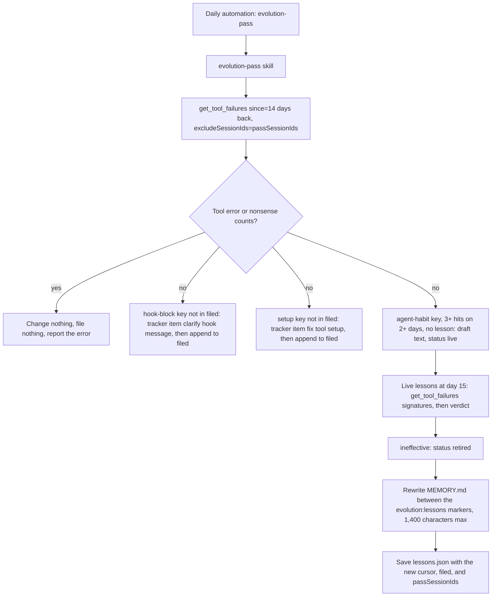

Design read: nimbalyst/ at 813acfb4c.

# Evolution loop v1 — Design

**Status:** Draft — the owner approved all five design sections on 2026-11-24; pending review of this document
**Author:** Squire generalist, written from the owner-approved design
**Date:** 2026-11-24
**CR:** 3
**Parent handoff:** none. Sources: `docs/research/2026-11-23-evolution-loop-approaches.md` and `docs/research/2026-11-23-hermes-atlas-evolution-adaptation.md`.

All paths below are relative to the `nimbalyst/` clone unless they start with `docs/` (this workspace) or `~/`. Commands run from inside `nimbalyst/`.

---

## Idea Brief

The two research documents hold the full record. This section is the short form. The sections below expand it.

### Asked

- Problem: answered: Nimbalyst agents repeat the same tool failures, and nothing measures whether a fix works. 2,207 failed tool results in 14 days; Edit failed 516 of 5,347 calls (9.7%).
- Target user: answered: the owner, on this machine, through Claude Code sessions in one workspace.
- Why now: answered: the gap review (2026-11-23) measured the failures and closed the first gap (a failure reader is possible for Claude Code). Source: `docs/research/2026-11-23-hermes-atlas-evolution-adaptation.md`, "Gap review".
- Scope (IN/OUT): answered. IN: a failure reader, a sorter, and a lessons extension (v1). OUT: the core prompt hook, Codex failure reading, a dashboard.
- Success test: answered: after 30 days, at least 5 lessons have a verdict (`effective` or `ineffective`; `inconclusive` does not count), Edit failures drop from 9.7% to under 5%, and every hook that blocked 20+ times has a proposal in the tracker.
- Kill condition: none given by the owner. DM fallback: if after 30 days fewer than 2 lessons have a verdict (`effective` or `ineffective`), stop and review the thresholds before building the core prompt hook. See Settled during spec review.
- Biggest worry: answered: lessons add noise to the prompt, or verdicts retire good lessons because workload changed. See Risks.
- Feature flag: answered: none added. The built-in extension is the switch. The owner turns it off in the extension list, and the daily automation is a normal automation that the owner can disable.

### Derived from the repo

| Item | Finding | Source |
|------|---------|--------|
| Existing reader | `handleGetSessionCoachingSignals` reads `ai_agent_messages` for one session. It does not return an error field. | `packages/electron/src/main/mcp/sessionContextServer.ts:263-288` |
| Reusable row type and synthetic check | `CoachingMessageRow` and `isSyntheticPrompt` are exported and pure. | `packages/electron/src/main/mcp/sessionCoachingSignals.ts:20-26`, `:105-117` |
| Test seam for a handler | `MessageRowDb` is a one-method database interface that the existing handler test fakes. | `packages/electron/src/main/mcp/sessionContextServer.ts:78-80`; `packages/electron/src/main/mcp/__tests__/sessionContextServer.lastAssistantResponse.test.ts:1-12` |
| Plugin delivery for extensions | Extension plugin paths reach the SDK as `options.plugins`. | `packages/runtime/src/ai/server/providers/claudeCode/sdkOptionsBuilder.ts:387-391` |
| Extension to copy | `planning` has `manifest.json`, `package.json`, `claude-plugin/.claude-plugin/plugin.json`, `claude-plugin/commands/`, and `claude-plugin/skills/planning/SKILL.md`. | `fd -H -t f . claude-plugin` in `packages/extensions/planning`, this session |
| New automations start off | `createDefaultAutomationStatus` sets `enabled: false`. The create tool accepts `enabled`. | `packages/extensions/automations/src/frontmatter/types.ts:113`; `packages/extensions/automations/src/index.tsx:219,230` |
| Tool name lists | Each first-party MCP tool name sits in a topology list. Session-context tools sit in `HOST_TOOLS`. | `packages/runtime/src/ai/server/services/mcpTopology.ts:128`, `:147-152` |
| Table columns | `ai_agent_messages` has `session_id`, `created_at`, `content`, `metadata`, `hidden`. `ai_sessions` has `created_at` (indexed). | `packages/electron/src/main/database/sqlite/schemas/0001_initial.sql:157-165`, `:61`, `:66` |
| Failure counts | 2,207 failures in 14 days; hook blocks 842; Edit 516 of 5,347; 31 ExitPlanMode `planFilePath` failures are all hook blocks. | `docs/research/2026-11-23-hermes-atlas-evolution-adaptation.md` "Gap 1"; `docs/research/2026-11-23-evolution-loop-approaches.md` fold row 8. Not re-run in this session. |
| Codex volume | 27 Codex tool rows in 14 days. | `docs/research/2026-11-23-hermes-atlas-evolution-adaptation.md` "Gap 1". Not re-run in this session. |
| Docstring record in repo `docs/` | The repo records no TSDoc `Args::type` adaptation. Search for `docstring`, `tsdoc`, `jsdoc` in `docs`, `.claude`, and the three `CLAUDE.md` files returned no file. A control search for `IPC` in `docs/IPC_GUIDE.md` returned 26, so the search works. | `rg -il "docstring\|tsdoc\|jsdoc"`, this session |
| Existing TS doc style | Mixed. `sessionCoachingSignals.ts` uses prose JSDoc. `mcpImageCompression.ts:14-15` uses `@param`. | `packages/electron/src/main/mcp/` |

---

## Problem

*Expands the Idea Brief's Problem row.*

Agents in Nimbalyst fail the same tool calls again and again. Most failures are not agent habits. Hook blocks make up 38% of failures (842 of 2,207), and some tools fail on every call. A lesson that repeats a hook message adds prompt text and fixes nothing. No part of Nimbalyst counts these failures per cause, writes a lesson for a real habit, or checks 14 days later whether the lesson helped. `memory-spike learn` writes lessons but never measures them.

---

## User Goal Anchor

- user-request: "look up the hermes plugin hermes-atlas-evolution and see how we can adapt it to nimbalyst" (user-message: 2026-11-23; session id not recorded; quote from the Nimbalyst session of 2026-11-23)
- target-artifact: `docs/research/2026-11-23-hermes-atlas-evolution-adaptation.md` (the gap review, which holds the measured baselines: Edit 516 of 5,347 = 9.7%, 842 hook blocks, 3 tools that failed on every call)
- convergence-test:

| Target element | Delivered by | Acceptance test |
|----------------|--------------|-----------------|
| At least 5 lessons have a verdict (`effective` or `ineffective`; `inconclusive` does not count) after 30 days | Units U3 and U4 (skill and first run), reading from U1 and U2 | `jq '[.lessons[] | select(.verdict == "effective" or .verdict == "ineffective")] | length' nimbalyst-local/evolution/lessons.json` prints 5 or more. `nimbalyst-local/` is in the root of the workspace the automation runs in, as the automations extension's own `nimbalyst-local/automations/` is. Live-session-only: needs 30 days of real runs. |
| Edit failures fall from 9.7% to under 5% | Units U1, U2, U3 | Call `get_tool_failures` with `since` set 14 days back. The Edit failures divided by Edit calls over that window is under 0.05. Live-session-only: needs 30 days. |
| Every hook that blocked 20+ times has a proposal in the tracker | Unit U3 (skill step for `hook-block` keys) | For each `hook-block` key with `failures >= 20` over 30 days in the `get_tool_failures` output, a tracker item titled "clarify hook message" names that key. Live-session-only. |
| Atlas rules adopted: 3+ hits on 2+ days; 14-day before and after windows; retire on `ineffective` | Unit U1 (math) and U3 (skill) | `pnpm --filter @nimbalyst/electron exec vitest run src/main/mcp/__tests__/toolFailures.test.ts` passes. |

---

## User Stories

1. As the owner, I want every failed tool call sorted into one bucket, so that a hook block never turns into a lesson.
2. As the owner, I want a clearer hook message proposed in the tracker when a hook blocks the agent often, so that the fix lands in the hook and not in the prompt.
3. As the owner, I want a "fix tool setup" tracker item when a tool fails on nearly every call, so that a broken tool gets fixed and is not worked around.
4. As the owner, I want a short "when X, do Y" lesson for a real agent habit that repeats on 3+ hits across 2+ days, so that the agent stops repeating it.
5. As the owner, I want each lesson to go live without an approval step, so that the loop runs unattended (Atlas auto mode).
6. As the owner, I want each live lesson judged after 14 days against the 14 days before, so that I know whether the lesson helped.
7. As the owner, I want a lesson retired when its verdict is `ineffective`, so that the prompt does not keep dead lessons.
8. As the owner, I want a verdict of `inconclusive` when the data is thin, so that a lesson is not retired on noise.
9. As the owner, I want the lessons text capped at 1,400 characters, so that lessons do not crowd the prompt.
10. As the owner, I want the pass to edit only the text between the two `evolution:lessons` markers in `MEMORY.md`, so that the `memory-spike learn` section stays intact.
11. As the owner, I want the markers added near the top of `MEMORY.md` when they are missing, so that a first run works on a fresh file and the lessons stay inside Claude Code's load limit (the first 200 lines or 25 KB).
12. As the owner, I want the daily pass to start by itself, so that I do not type a command each day.
13. As the owner, I want the pass to skip a day when no Nimbalyst window is open and read the full 14-day window on the next run, so that no day is lost or counted twice.
14. As the owner, I want the pass to count nothing from its own sessions, so that the loop does not measure itself.
15. As the owner, I want the pass to change nothing and file nothing when the tool returns an error or counts that make no sense, so that a bad read never writes a bad lesson.
16. As the owner, I want the pass to report that error in its run output, so that I can see why a day did nothing.
17. As the owner, I want a watched first run that checks the memory write, so that an unattended run does not hang on a permission prompt.
18. As the owner, I want to see that a session in a git worktree loads the lessons, so that I know where lessons reach and where they do not.
19. As a Claude Code agent, I want the live lessons in my memory file at session start, so that I avoid a known failure before my first call.
20. As the owner, I want one state file for lessons (`nimbalyst-local/evolution/lessons.json`), so that there is one place to read and one place to reset.
21. As an upstream maintainer, I want the core change to be one module and one MCP tool with tests, so that the pull request is small.
22. As the owner, I want no Codex reading in v1, so that v1 stays small. Codex has 27 tool rows in 14 days.

---

## Success Criteria

*Expands the Idea Brief's Scope (IN) and Success test rows. Each line describes the built system.*

1. `packages/electron/src/main/mcp/toolFailures.ts` exists and exports pure functions that pair `tool_use` with `tool_result` by `tool_use_id`, put each failure in exactly one bucket, count per key per UTC day, and compute before and after rates.
2. `rg -n "get_tool_failures" packages/electron/src/main/mcp/sessionContextServer.ts packages/runtime/src/ai/server/services/mcpTopology.ts` shows the tool in the tool list, the dispatch `case`, and `HOST_TOOLS`.
3. A call to `get_tool_failures` for a different workspace's data returns only rows from the caller's workspace. The handler always leaves out the caller's own session, and the result names that session in `callerSessionId`.
4. `get_tool_failures` returns at most 3 sample details per key and at most 3 unmatched `other` samples per day.
5. `packages/extensions/evolution/manifest.json` declares a `claudePlugin` with `enabledByDefault` set to `true`, and `packages/extensions/evolution/claude-plugin/skills/evolution-pass/SKILL.md` exists. The extension holds no backend module.
6. After the watched first run, the folder `nimbalyst-local/automations/` holds an automation for `evolution-pass` with `enabled: true`.
7. `nimbalyst-local/evolution/lessons.json` holds a `cursor`, a `filed` array, a `passSessionIds` array, a `lessons` array and, for each lesson in `lessons`, the fields `id`, `signature`, `tool`, `klass`, `text`, `status`, `activatedAt`, `verdict`, `rateBefore`, `rateAfter`, `evaluatedAt`.
8. A lesson reaches status `live` only when its key has 3 or more hits on 2 or more distinct UTC days.
9. A lesson at day 15 with verdict `ineffective` has status `retired` and its text is absent from `MEMORY.md`.
10. The text between `<!-- evolution:lessons:start -->` and `<!-- evolution:lessons:end -->` is 1,400 characters or fewer, and every other line of `MEMORY.md` is unchanged by a pass.
11. A key with fewer than 20 calls in either window, or fewer than 5 failures in the before-window, gets verdict `inconclusive`.
12. After 30 days: at least 5 lessons have a verdict (`effective` or `ineffective`), the Edit failure rate is under 5%, and every `hook-block` key with 20 or more blocks has a tracker item.

---

## Non-Goals

*Expands the Idea Brief's Scope (OUT) row.*

- Not the core prompt hook. Making `registerContextProvider` work, so Codex gets lessons, is a later sub-project.
- Not Codex failure reading. Codex has 27 tool rows in 14 days.
- Not a dashboard or settings panel.
- Not a new database table or schema migration.
- Not `nimbalyst-memory` facts. `lessons.json` is the single store.
- Not a backend module in the extension. The extension has no code.
- Not a new SDK surface for extensions.
- Not an approval step for lessons. This repo bans new gates nobody asked for (`.claude/rules/no-unrequested-restrictions.md`). The owner chose auto mode.
- Not a replacement for `memory-spike learn` or `get_session_coaching_signals`. Both stay as they are.
- Not a run while no Nimbalyst window is open (accepted).

Decomposition status: decomposed: v1 is sub-project 1 of 3; the core prompt hook and the Codex reader are later sub-projects.

---

## Intake Sheet

| Decision | Answer | Source |
|----------|--------|--------|
| Approach | Approach 1: core counts, agent judgment | `user` (approved 2026-11-24) |
| Scope v1 | Failure reader, sorter, lessons extension | `user` |
| Code home | The owner's fork first, then upstream pull requests for the core parts | `user` |
| Go-live | Atlas auto mode. Live after 3+ hits on 2+ days. Retired on verdict `ineffective`, checked on day 15. | `user` |
| Lesson store | `nimbalyst-local/evolution/lessons.json`, no `nimbalyst-memory` facts | `user` |
| Delivery | Marked section of the workspace auto-memory `MEMORY.md`, 1,400 characters at most | `user` |
| Memory folder path | The skill writes to the memory folder that Claude Code names in its own context. No path encoding. If the skill sees no memory folder path, it stops and changes nothing. The Claude Code docs do not promise that the path is shown (Augur, `docs/research/2026-11-24-evolution-loop-augur.md`). | `user` |
| Automation creation | The skill's setup step calls the automations create tool with `enabled: true` | `user` |
| Codex | Not read in v1 | `user` |
| Test framework | vitest, `// @vitest-environment node` first | `derived: nimbalyst/CLAUDE.md` (Tests and the gate) |
| Handler test file | Extend `sessionContextServer.lastAssistantResponse.test.ts` | `derived: nimbalyst/CLAUDE.md` ("Extend an existing test file before creating one") |
| Effective and ineffective cut-offs | Adopt Atlas's: effective when the after rate is at most 50% of the before rate; ineffective when the after-window has 3+ failures and the after rate is at least 90% of the before rate | `derived: ~/.hermes/plugins/hermes-atlas-evolution/hermes_atlas_evolution/lessons.py:794-796` |
| Research dispatch for the API surface | Not needed. Every surface was read in this repo. | `derived: Verified API Surface below` |

---

## Conventions Contract

| Field | Resolution |
|-------|------------|
| Project Structure | `adopt-existing:packages/electron/src/main/mcp/` (new module beside `sessionCoachingSignals.ts`, tests in its `__tests__/`) and `adopt-existing:packages/extensions/planning/` (extension layout) |
| Documentation Standards | `decide-fresh:` TSDoc with `Args::type` sections per `~/.claude/rules/docstrings.md`, and comments that say WHY and not WHAT (the style of the header in `sessionCoachingSignals.ts:1-17`). The repo records no docstring standard (see Idea Brief), so detection found nothing. The existing style is mixed: prose JSDoc in `sessionCoachingSignals.ts`, and `@param` JSDoc in `packages/electron/src/main/mcp/mcpImageCompression.ts:14-15`. The fork uses the owner's `Args::type` layout anyway, because the owner's global rule `~/.claude/rules/docstrings.md` asks for it. The owner decides on conversion before upstream. |
| Linter | `adopt-existing:package.json` scripts `typecheck` and `check:*`. `typecheck` runs through `scripts/nim-gate` on this machine (`nimbalyst/CLAUDE.md`). No ESLint, Biome, or Prettier config was found at the repo root (`fd -d 1 -H 'eslint\|biome\|prettier\|editorconfig'` returned nothing). |
| LSP | `adopt-existing:typescript-language-server`, from the owner's auto-memory note `typescript-lsp-setup` |

---

## Docstring Standard

| Language | Standard | Linter | Note |
|----------|----------|--------|------|
| TypeScript | The `Args::type` layout of `~/.claude/rules/docstrings.md`, written in TSDoc form | none (see Conventions Contract) | The repo does not record this adaptation. Unit U0 writes it into `docs/` after the doc tool is checked. The doc check tool is `pnpm typecheck` (it passes with the TSDoc comments in place) plus the IDE hover, which shows each section. The fork uses this layout for all files, core files included. Before the first upstream pull request, the owner decides whether to convert core files to prose JSDoc. See Settled during spec review. |

---

## Prior Art

| Candidate | Where it was searched | Verdict | Why |
|-----------|----------------------|---------|-----|
| `deriveCoachingSignals`, `CoachingMessageRow`, `isSyntheticPrompt` | `packages/electron/src/main/mcp/sessionCoachingSignals.ts:20-26,105-117,210` | adopt (reuse the row type and the synthetic check) | They already parse `ai_agent_messages` rows and tell typed prompts from machine prompts. The new module sits beside them. It does not copy them. |
| `memory-spike learn` | `~/.claude/projects/-Volumes-josh-external-Projects-Nimbalyst/memory/MEMORY.md` ("Memory-Spike Learned Patterns") | reject as the engine; keep its section | It writes lessons but has no measurement and no retirement. It has a different owner. The pass must not touch its section. |
| Atlas Evolution (`hermes-atlas-evolution` 0.13.0) | `~/.hermes/plugins/hermes-atlas-evolution/hermes_atlas_evolution/lessons.py`; `docs/research/2026-11-23-hermes-atlas-evolution-adaptation.md` | reject a port; adopt its rules and thresholds | The code is Python on Hermes hooks (28,226 lines, mostly Hermes upkeep). The rules carry over: 3+ hits, 14-day windows, retire after 14 days (`lessons.py:23-27`, `:635`), and the verdict cut-offs (`lessons.py:794-796`). Two differences are deliberate. Atlas accepts 2+ sessions OR 2+ days; this spec uses 2+ days only. Atlas judges at 5 days or 20 calls; this spec judges at day 15. |
| `automations` extension | `packages/extensions/automations/src/index.tsx:202-230` | adopt | It already runs a prompt on a daily schedule and accepts `enabled: true`. No scheduler is written. |
| `nimbalyst-memory` facts store | `packages/extensions/nimbalyst-memory` (listed in `packages/marketplace/release-extensions.txt`) | reject | A second store for lesson text would hold the same data as `lessons.json`. One store is simpler (critique fold row 12). |
| Claude plugin skill in an extension (`claudePlugin`) | `packages/extensions/planning/manifest.json:28-59`; `sdkOptionsBuilder.ts:387-391` | adopt | It needs no new SDK surface. The skill runs as a normal agent session. |
| Stats library for before and after rates | `rg -n '"mathjs"' packages --glob '**/package.json'`: one hit, `packages/extensions/calc-sheets/package.json:18` (`mathjs` 15.2.0). `mathjs` has `erf` but no z-test or Fisher test. `fishers-exact-test` on npm is old and barely used. | reject, no library warranted | The rate is `failures / calls`, a ratio of two counts. The verdict compares two ratios with fixed cut-offs. Native arithmetic does this. The rule is a screening rule, not a significance test: at the minimum counts a Fisher exact test gives p = 0.41 for 5/20 vs 2/20 (Augur). The `inconclusive` verdict and the day-45 limit carry that weakness. |
| `vitest` fake data and the `MessageRowDb` fake | `sessionContextServer.lastAssistantResponse.test.ts` | adopt | The same fake-database pattern tests the new handler. |
| Date handling (UTC day keys) | JavaScript standard library (`Date`, `toISOString().slice(0, 10)`) | adopt | The standard library covers UTC day keys. No date library is added. |
| JSON read and write of `lessons.json` | `JSON.parse` and `JSON.stringify`, run by the agent skill through normal file tools | adopt | No parser is written. |

---

## Verified API Surface

Every row below was opened in this session. Line numbers are from `nimbalyst/` at `813acfb4c`.

| API / flag / schema | How it was verified | Source |
|---------------------|---------------------|--------|
| Automation create tool, argument `enabled` (boolean, default false), read as `args.enabled === true` | in-repo citation | `packages/extensions/automations/src/index.tsx:219,230` |
| Automation create tool: the extension registers `automations.create`, and agents see it as the MCP tool `mcp__nimbalyst-automations__automations_create` | in-repo citation, settled in spec review 2026-11-24 | `packages/extensions/automations/src/index.tsx:203` |
| `createDefaultAutomationStatus` sets `enabled: false` | in-repo citation | `packages/extensions/automations/src/frontmatter/types.ts:106-113` |
| `options.plugins` set from extension plugin paths, unless `explicitOnly` | in-repo citation | `packages/runtime/src/ai/server/providers/claudeCode/sdkOptionsBuilder.ts:387-391` |
| `handleGetSessionCoachingSignals` SELECT: `content, message_kind, searchable_text, metadata, hidden` from `ai_agent_messages` for one session, ordered by `id` | in-repo citation | `packages/electron/src/main/mcp/sessionContextServer.ts:282-288` |
| Workspace check in that handler: `workspaceId` is the workspace path and is compared with `session.workspacePath` | in-repo citation | `packages/electron/src/main/mcp/sessionContextServer.ts:274-278` |
| `isSyntheticPrompt(text, metadata)` | in-repo citation | `packages/electron/src/main/mcp/sessionCoachingSignals.ts:105-117` |
| `CoachingMessageRow` fields: `content`, `message_kind`, `searchable_text`, `metadata`, `hidden` (no `session_id`, no `created_at`) | in-repo citation | `packages/electron/src/main/mcp/sessionCoachingSignals.ts:20-26` |
| `claudePlugin` contribution: `path`, `displayName`, `description`, `enabledByDefault`, `commands`. Skills are not listed in the manifest. | in-repo citation | `packages/extensions/planning/manifest.json:28-59` |
| Plugin metadata file `claude-plugin/.claude-plugin/plugin.json` | in-repo citation | `packages/extensions/planning/claude-plugin/.claude-plugin/plugin.json` |
| Skill file frontmatter: `name`, `description` | in-repo citation | `packages/extensions/planning/claude-plugin/skills/planning/SKILL.md:1-4` |
| MCP tool entry shape (`name`, `description`, `inputSchema`) and the dispatch `case` | in-repo citation | `packages/electron/src/main/mcp/sessionContextServer.ts:713-728`, `:892-902` |
| Tool name lists by server; session-context tools sit in `HOST_TOOLS`; tools are named `mcp__<configKey>__<tool>` and the host key is `nimbalyst-host` | in-repo citation | `packages/runtime/src/ai/server/services/mcpTopology.ts:5-8,58,128,147-152` |
| Injectable database interface `MessageRowDb` | in-repo citation | `packages/electron/src/main/mcp/sessionContextServer.ts:78-80` |
| Built-in extension folder in development is `packages/extensions` (path resolved four levels up from `__dirname`) | in-repo citation | `packages/electron/src/main/extensions/builtinExtensionsDirectory.ts:18-33` |
| Table columns for `ai_agent_messages` and `ai_sessions.created_at` (SQLite schema) | in-repo citation | `packages/electron/src/main/database/sqlite/schemas/0001_initial.sql:157-165,61,66` |
| Package names: `@nimbalyst/electron`, `@nimbalyst/runtime` | in-repo citation | `jq -r .name packages/electron/package.json packages/runtime/package.json`, this session |
| Atlas verdict rule and constants | external source read | `~/.hermes/plugins/hermes-atlas-evolution/hermes_atlas_evolution/lessons.py:23-27,792-797` |
| Row shapes: user row `{type:'user', message:{content:[{type:'tool_result', tool_use_id, is_error, content}]}}` and assistant row with a `tool_use` block | research doc and database query | `docs/research/2026-11-23-hermes-atlas-evolution-adaptation.md` "Gap 1". The assistant `tool_use` shape is also at `sessionCoachingSignals.ts:162-172`. Verified by a database query on 2026-11-23: a failed Claude Code result row's `content` starts `{"type":"user","message":{"role":"user","content":[{"type":"tool_result","content":"PreToolUse:Bash hook error: ...","is_error":true,"tool_use_id":...`. |
| `ai_sessions.workspace_id` holds the workspace path | database query, 2026-11-24 | Example value: `/Users/joshuarichter/Documents/Projects/Tools/Phoenix`. |
| Every session-context handler receives `currentSessionId` | in-repo citation | `packages/electron/src/main/mcp/sessionContextServer.ts`, for example `handleGetSessionCoachingSignals` at `:263-268` |
| An automation run starts a new session through `ai.sendPrompt` with `sessionName: "Automation: <title>"` | in-repo citation | `packages/extensions/automations/src/index.tsx:72-77` |
| `enabledByDefault` in built-in extension manifests always uses `true` (13 extensions: animation, automations, canvas, crew, datamodellm, developer, excalidraw, extension-dev-kit, feedback, ios-dev, knowledge, mockuplm, planning) | in-repo citation, settled in spec review 2026-11-24 | the manifest of each named extension under `packages/extensions/` |

Verified on 2026-11-24: the tracker tool names the skill uses to search and create items, by ToolSearch schema (`mcp__nimbalyst-trackers__tracker_create`, `mcp__nimbalyst-trackers__tracker_list`).

**Still unverified (carried forward):**

- The PGLite form of `created_at` (the SQLite schema was read; `DATABASE.md` says both backends are live). The first test fixtures must come from real rows.
- Whether a skill needs a manifest entry. `planning` lists commands only and ships one skill, which suggests it does not.

**Verified since (closed items):**

- Effect of a tool missing from `mcpTopology.ts`: see Affected Consumers. A tool missing from `HOST_TOOLS` fails a test, and U2 adds the name.
- Packaged builds: packaging copies `../extensions` including `**/claude-plugin/**`, `manifest.json`, and `package.json` (`packages/electron/package.json:412-420`). No extra release list entry is needed.
- The `message_kind` of Claude Code `tool_result` rows is `tool`, and `created_at` is ISO text such as `2026-11-24T09:53:38.926Z` on SQLite (database query, 2026-11-24). The pairing code still does not depend on `message_kind`.

---

## Design



### D1 — Shape

Approach 1: the core counts and the agent judges. Core code does the arithmetic and is under unit tests. An agent skill does the wording and the filing. This split means the numbers that decide a verdict never come from a model.

Four parts:

| Part | Place | Kind |
|------|-------|------|
| (a) Failure math | `packages/electron/src/main/mcp/toolFailures.ts` | pure functions, new |
| (b) MCP tool `get_tool_failures` | registered in `packages/electron/src/main/mcp/sessionContextServer.ts` | workspace-scoped tool |
| (c) Extension `evolution` | `packages/extensions/evolution/` | manifest and one skill, no backend code |
| (d) State | `nimbalyst-local/evolution/lessons.json` | single store |

**Alternatives considered:**
- Option A: everything in core (an `EvolutionService`, a new table, a timer, a settings panel, template lessons) — rejected: the largest core diff, the hardest upstream review, and template lessons are generic.
- Option B: a TypeScript extension with a new backend SDK service for transcripts — rejected: two core changes, one of them a new public SDK surface that upstream must agree to keep, and an agent is still needed for the wording.
- Option C: Approach 1 — adopted.

### D2 — The sorter

The pairing skips rows with `hidden` set, the same as `deriveCoachingSignals` (`packages/electron/src/main/mcp/sessionCoachingSignals.ts:217`).

One failure goes into exactly one bucket. The rules run in this order:

1. `hook-block`. The result text matches the hook pattern list. The list lives in one exported constant in `toolFailures.ts`. It starts with `PreToolUse:<Tool> hook error:`, `[plan-gate] BLOCKED`, `[commander-rule] BLOCKED`, `Hook PreToolUse`, and Claude Code's own `<tool_use_error>Blocked:` (key `claude-code-builtin`). Key: the hook's name, taken from the text in this order: the script file name in `["$HOME/.claude/hooks/<name>.py"]` gives `<name>`; a bracket tag such as `[plan-gate]` gives `plan-gate`; the word after a leading `RPG ` such as `RPG destructive-guard` gives `destructive-guard`; otherwise the first 40 characters after `hook error: `. Output: a tracker item "clarify hook message". For a `hook-block` key, `calls` counts the calls of the tool the hook blocked.
2. `setup`. Over the window, non-hook failures are 90% or more of a tool's calls, and the tool has at least 10 calls. Key: the tool. A result that starts `<tool_use_error>Error: No such tool available:` goes to `setup` at once, keyed by the tool, with no rate check: the tool cannot run in this setup. Output: a tracker item "fix tool setup". Hook blocks are not counted here, so a tool blocked only by a hook stays in bucket 1. All 31 ExitPlanMode `planFilePath` failures are hook blocks, so ExitPlanMode lands in `hook-block`. The tool computes the `setup` keys, not the skill. The 90% denominator is all calls of the tool, hook-blocked calls included.
3. `agent-habit`. Everything else. Key: tool plus failure class. The classes are `exit-code`, `edit-precondition`, `missing-file`, `bad-input`, `timeout`, `denied`, and `other`. Output: a lesson candidate when the key has 3+ hits on 2+ days and no lesson of any status. A retired key is never drafted again.

The class patterns sit beside the hook list in the same file. Tests pin each pattern with a fixture copied from a real row. The first list, with counts from `database_query` on 2026-11-24 for rows since 2026-11-10 (result text start, `is_error` true):

| Match (start of the result text) | Bucket or class | Rows |
|:--|:--|--:|
| `<tool_use_error>File has not been read yet` | `edit-precondition` | 373 |
| `PreToolUse:Bash hook error: RPG destructive-guard` | `hook-block`, key `destructive-guard` | 296 |
| `PreToolUse:Bash hook error: ["$HOME/.claude/hooks/...` | `hook-block`, key from the script name (for example `model-gate-git`, `paper-gate`) | 142 |
| `PreToolUse:Bash hook error: Recursive grep block` | `hook-block`, key `recursive-grep` | 80 |
| `<tool_use_error>File has been modified since read` | `edit-precondition` | 72 |
| `File does not exist.` | `missing-file` | 36 |
| `<tool_use_error>Error: No such tool available:` | `setup` (see rule 2) | 109 |
| `Exit code <n>` | `exit-code` | 27+ |
| `<tool_use_error>String to replace not found`, `<tool_use_error>No changes to make` | `edit-precondition` | 19 |
| `The user doesn't want to take this action`, `Permission for this command was denied` | `denied` | 18 |
| `<tool_use_error>Blocked:` | `hook-block`, key `claude-code-builtin` | 38 |
| `<tool_use_error>InputValidationError`, `This tool's input schema` | `bad-input` | 11 |
| text containing `timed out` | `timeout` | few |
| anything else | `other` | rest |

A call whose `tool_use` has no matching `tool_result` row is not counted, as a call or as a failure.

### D3 — The tool `get_tool_failures`

Inputs: `{ since: ISO string, signatures?: { signature: string; activatedAt: string }[], excludeSessionIds?: string[] }`. `since` is cut down to 00:00 UTC of its day, so each window holds whole UTC days.

The handler:
- takes the workspace path from the caller, as `handleGetSessionCoachingSignals` does, and reads only sessions of that workspace;
- reads rows from `ai_agent_messages` joined to `ai_sessions` on `session_id`, and keeps rows with `created_at >= since`;
- drops sessions listed in `excludeSessionIds`, and always drops the caller's own session (`currentSessionId`);
- calls the pure function in `toolFailures.ts`.

It returns:
- bucketed daily counts: for each UTC day, each bucket, each key, `{ calls, failures }`. `calls` is the number of calls of that key's tool on that day;
- for each `agent-habit` key, `hits` and `distinctDays` over the window. `hits` counts the failures of that key. `distinctDays` counts the UTC days with at least one failure. The tool owns the habit gate, and the skill only reads `hits >= 3 && distinctDays >= 2`;
- up to 3 sample details per key (session id and a short text);
- up to 3 unmatched `other` samples per day, so the pattern lists can grow;
- for each given signature, the before and after counts and the verdict (D4). The tool computes the verdict; the skill only saves it in `lessons.json`.
- a `truncated` flag, as `get_session_coaching_signals` has. It is true when a cap is hit: each sample text is cut to 200 characters, and at most 200 keys are returned, most failures first;
- `callerSessionId`, the id of the session that made the call, so the skill can record it in `passSessionIds`.

The query (the handler passes the workspace id, `since`, and the excluded session ids as parameters; `ai_sessions` has `id`, `workspace_id`, `created_at`):

```sql
SELECT m.session_id, m.created_at, m.content, m.message_kind, m.hidden, s.created_at AS session_created_at
FROM ai_agent_messages m JOIN ai_sessions s ON s.id = m.session_id
WHERE s.workspace_id = $1 AND m.created_at >= $2 AND m.message_kind = 'tool'
  AND NOT (m.session_id = ANY($3))
ORDER BY m.id ASC
```

The plan checks `= ANY($3)` on both PGLite and SQLite (`packages/electron/DATABASE.md`) and swaps it for a generated `NOT IN` list if SQLite rejects it. The row type extends `CoachingMessageRow` (`sessionCoachingSignals.ts:20`) with `session_id`, `created_at`, and `session_created_at`.

Both the `tool_use` and the `tool_result` rows have `message_kind = 'tool'`: `database_query` on 2026-11-24 found 43,427 such rows since 2026-11-20, all with that kind, `direction = 'output'` and `source = 'claude-code'`. The filter keeps both halves of each pair.

```ts
interface ToolFailuresResult {
  days: { day: string; bucket: 'hook-block' | 'setup' | 'agent-habit'; key: string; calls: number; failures: number }[];
  habitKeys: { key: string; hits: number; distinctDays: number }[];
  setupKeys: { key: string; calls: number; failures: number }[];
  samples: { key: string; sessionId: string; text: string }[];
  otherSamples: { day: string; sessionId: string; text: string }[];
  verdicts: { signature: string; before: { calls: number; failures: number }; after: { calls: number; failures: number }; verdict: 'effective' | 'ineffective' | 'inconclusive' }[];
  truncated: boolean;
  callerSessionId: string;
}
```

The handler body is an exported function `fetchToolFailures(db: MessageRowDb, workspaceId, args)`, so a test can pass a fake database. This is the same pattern as `fetchLastAssistantResponse` (`sessionContextServer.ts:95`). Database access uses the static import that `sessionContextServer.ts:12` already has (`import { database } from '../database/PGLiteDatabaseWorker'`). `packages/electron/MAIN_PROCESS_INIT.md:20` allows a dynamic import only in `bootstrap.ts`. The sibling handlers' `await import("../database/initialize")` (`sessionContextServer.ts:141`, `:280`, `:496`) is not copied. The pure module `toolFailures.ts` imports no database code.

### D4 — Verdict math

A signature is the agent-habit key written as `<tool>:<klass>`. The rate for a signature is its failures divided by the calls of its tool in the window.

| Window | Definition |
|--------|------------|
| Before | The 14 days before `activatedAt`. |
| After | Starts the day after `activatedAt`, lasts 14 days. It counts only sessions created after `activatedAt`. It excludes the pass's own sessions. |

Verdict rules, in order:
1. `inconclusive` when either window has fewer than 20 calls for the key, or the before-window has fewer than 5 failures.
2. `effective` when the after rate is at most 0.5 times the before rate.
3. `ineffective` when the after-window has 3 or more failures and the after rate is at least 0.9 times the before rate.
4. Otherwise `inconclusive`.

Rules 2 and 3 are Atlas's cut-offs (`lessons.py:794-796`). Rule 1 is the owner-approved limit, and it replaces Atlas's own `base_failures == 0` check.

Verdict timing: the pass judges a live lesson when 15 or more days have passed since `activatedAt` and its verdict is `null` or `inconclusive`. Day 15 is the first day after the 14-day after-window ends. An `inconclusive` lesson is judged again on each later pass until day 45. After day 45, an `inconclusive` lesson stays live and the pass does not judge it again. (Day 45 is a DM default from the spec review on 2026-11-24, not an owner decision or an Atlas rule.) `evaluatedAt` is the time of the latest verdict.

"Has a verdict" means a verdict of `effective` or `ineffective`. `inconclusive` does not count.

Call arguments for the verdict call: `since` is the earliest `activatedAt` among the lessons being judged, minus 14 days. `excludeSessionIds` is `passSessionIds`. The handler also always excludes `currentSessionId`.

### D5 — State file `nimbalyst-local/evolution/lessons.json`

One file. It holds a cursor, a list of filed keys, a list of pass session ids, and a list of lessons. The cursor marks the last UTC day the pass finished. It does not limit the read: every pass reads the last 14 days (D6).

| Field | Meaning |
|-------|---------|
| `id` | Lesson id |
| `signature` | `<tool>:<klass>` |
| `tool` | Tool name |
| `klass` | Failure class |
| `text` | The lesson, a short "when X, do Y" |
| `status` | `live` or `retired` |
| `activatedAt` | ISO time the lesson went live |
| `verdict` | `effective`, `ineffective`, `inconclusive`, or `null`. "Has a verdict" means `effective` or `ineffective`. |
| `rateBefore`, `rateAfter` | Rates from the tool |
| `evaluatedAt` | ISO time of the last verdict |

The file also holds these top-level fields:

| Field | Meaning |
|-------|---------|
| `cursor` | The last UTC day a pass finished. It marks progress and does not limit the read. |
| `filed` | Array of `{ key, bucket, trackerItemId, filedAt }`, one entry for each tracker item the skill filed. The skill files an item only for a key that is not in `filed`, then appends to it. It runs no tracker search. |
| `passSessionIds` | The last 30 run session ids, newest first. The skill passes them as `excludeSessionIds` and adds its own id from the tool result field `callerSessionId`. |
| `lessons` | The list of lessons, each with the fields above. |

`nimbalyst-local/` is a local folder that git must never commit (`nimbalyst/CLAUDE.md`, Data and safety).

### D6 — The `evolution-pass` skill

Setup step. The skill first calls `mcp__nimbalyst-automations__automations_list`. If an automation titled "Evolution pass" exists, setup is done. If not, the skill creates it through `mcp__nimbalyst-automations__automations_create` (the extension registers it as `automations.create`) with `enabled: true`, a daily schedule at 06:00 local time, and the prompt "Run the evolution-pass skill." A manifest cannot register an automation, and new automations start off, so the skill must pass `enabled`. The extension manifest sets `enabledByDefault: true`. Turning the extension on runs nothing by itself. The daily automation exists only after this setup step. Setup also records the memory folder path from its own context as `memoryDir` in `lessons.json`. A later run uses the path in its own context, or `memoryDir` when its context shows none; with neither, it stops (D6 failure handling).

Daily steps:
1. Read `lessons.json`. Take `filed` and `passSessionIds`. The cursor only marks the last finished day.
2. Call `get_tool_failures` with `since` set 14 days back and `excludeSessionIds` set to `passSessionIds`. The habit and setup counts use this 14-day read. Keep `callerSessionId` from the result.
3. For each `hook-block` key not in `filed`, file a tracker item "clarify hook message". For each `setup` key not in `filed`, file a tracker item "fix tool setup". After each filing, append `{ key, bucket, trackerItemId, filedAt }` to `filed`. The skill does not search the tracker. Filing uses `mcp__nimbalyst-trackers__tracker_create` with `type: "task"`, `title` ("Clarify hook message: <key>" or "Fix tool setup: <key>"), `description` (the counts and the 3 samples), and `labels: ["evolution", "<bucket>"]`. The returned id is the `trackerItemId` in `filed`. Tool schema checked on 2026-11-24 with ToolSearch.
4. For each `agent-habit` key with `hits >= 3 && distinctDays >= 2` in the tool result and no lesson of any status in `lessons.json` (a `retired` lesson counts, so a retired key is not drafted again), write the lesson text and add the lesson with status `live` and `activatedAt` set to now. The skill does not count hits or days itself.
5. For each live lesson with 15 or more days since `activatedAt` and a verdict that is `null` or `inconclusive` (and no more than 45 days since `activatedAt`), call `get_tool_failures` with `since` set to the earliest `activatedAt` among the lessons being judged minus 14 days, `excludeSessionIds` set to `passSessionIds`, and `signatures` set to each lesson's signature and `activatedAt`. The handler also always excludes `currentSessionId`. Save the verdict, the rates, and `evaluatedAt`. When the verdict is `ineffective`, set status `retired`.
6. Rewrite the lessons section of `MEMORY.md` (D7).
7. Save `lessons.json` with the new cursor, the updated `filed`, and `passSessionIds` with `callerSessionId` added at the front and the list cut to 30.

The skill writes to the memory folder that Claude Code names in its own context, so the skill never builds a path.

Failure handling:
- A tool error, or counts that make no sense: the pass changes nothing, files nothing, and reports the error in its run output.
- No memory folder path in the skill's context: the pass changes nothing and reports "no memory folder path" in its run output.
- Markers missing in `MEMORY.md`: the pass adds them right after the index lines at the top of the file, before any auto-generated section, and keeps the rest. Claude Code loads only the first 200 lines or 25 KB of the file.
- No Nimbalyst window open: the automation skips that day. The next run reads the full 14-day window, so no day is lost.

### D7 — Delivery through `MEMORY.md`

The pass edits `MEMORY.md` only between `<!-- evolution:lessons:start -->` and `<!-- evolution:lessons:end -->`. The text between them is 1,400 characters at most and lists the `live` lessons. `memory-spike learn` owns its own section in the same file ("Memory-Spike Learned Patterns"), and the pass never edits it. The two tools run at different hours. Each live lesson is one line: `- <lesson text> (<tool>/<class>)`, oldest first. A new lesson goes live only when the section still fits in 1,400 characters with it. If it does not fit, the candidate waits, is not added to `lessons.json`, and the run output names it. Every live lesson is therefore always shown, so its after-window counts are honest.

Claude Code loads this file at session start, up to 200 lines or 25 KB. The Claude Code docs say all worktrees of one git repo share one memory folder. This workspace folder is not a git repo, so its sessions use their own folder, and sessions in the `nimbalyst/` clone or its worktrees use the clone's folder. Lessons reach only the sessions that share the folder the pass writes. The first run checks this (Testing Decisions).

### D8 — Libraries (Rule 1)

| Part | Library |
|------|---------|
| Row types, synthetic-prompt check | `sessionCoachingSignals.ts` (`CoachingMessageRow`, `isSyntheticPrompt`) |
| JSON parse of row content | `JSON.parse` (standard library) |
| UTC day keys | `Date` (standard library) |
| Rates and verdicts | native arithmetic, as a screening rule; no stats library (see Prior Art) |
| MCP tool registration | `@modelcontextprotocol/sdk` types already imported in `sessionContextServer.ts:11` |
| Schedule | the `automations` extension |
| Tests | `vitest` (declared in the root `package.json`) |
| Skill file | Claude plugin format, as `planning` uses |
| Hook and class pattern lists | hand-written: a short list of `RegExp` values specific to Claude Code and local hook text. No library knows these messages. |
| Pairing and bucket counting | hand-written: about two loops over rows. The rules are Nimbalyst's own sorter. No library models them. |

---

## Seams

| Seam | New or existing | What crosses it | What gets tested here |
|------|-----------------|-----------------|-----------------------|
| `toolFailures.ts` exported functions | NEW | rows in; buckets, daily counts, and rates out | pairing, hidden rows skipped, each bucket, the ExitPlanMode hook case, the setup threshold, the habit gate (`hits`, `distinctDays`), before and after math, the `inconclusive` limits |
| `MessageRowDb` | existing (`sessionContextServer.ts:78`) | a fake database on one side, `fetchToolFailures` on the other | workspace scope, `since` filter, `excludeSessionIds`, the caller's own session left out, `callerSessionId` in the result, sample caps, signature input |
| First watched run of the skill | existing (a live session) | the agent session, `MEMORY.md`, the tracker | no permission prompt on the memory write, foreign sections survive, a worktree session loads the lessons, `filed` and `passSessionIds` are saved |

The skill is markdown. It has no automated seam, so a live check covers it. The owner approved this test list on 2026-11-24. The DM added the `currentSessionId`, `callerSessionId`, `filed`, and `passSessionIds` checks during spec review.

---

## Affected Consumers

`HOST_TOOLS` (`packages/runtime/src/ai/server/services/mcpTopology.ts:128`) has one direct reader, the topology table entry at `mcpTopology.ts:280`. The topology is read by `packages/runtime/src/ai/prompt.ts`, `packages/runtime/src/ai/server/services/mcpTokenBudget.ts`, `packages/runtime/src/ai/server/services/McpConfigService.ts`, `packages/runtime/src/ai/server/index.ts`, and `packages/electron/src/main/mcp/tools/editorToolHandlers.ts` (found with `rg -l "mcpTopology"`, 2026-11-24).

`SESSION_CONTEXT_TOOL_SCHEMAS` (`sessionContextServer.ts:695`) holds the new tool's schema. Its readers are `packages/electron/src/main/mcp/httpServer.ts:392` and `:481`, and `packages/electron/src/main/mcp/toolBudgetService.ts:105`. They pick up the new schema with no edit.

A schema in `SESSION_CONTEXT_TOOL_SCHEMAS` with no `HOST_TOOLS` entry fails the test "gives every declared host tool schema a topology mapping" in `packages/electron/src/main/mcp/__tests__/mcpEndpointRouting.test.ts:100-105`. That is the guard for this tool. `mcpToolBudget.characterization.test.ts` does not read `SESSION_CONTEXT_TOOL_SCHEMAS` (its schema list is at lines 37-49), so it does not guard this tool.

In code, `get_session_coaching_signals` appears only in `mcpTopology.ts`, `sessionCoachingSignals.ts`, and `sessionContextServer.ts`. The docs `docs/THE_HARNESS.md:128` and `packages/extensions/planning/claude-plugin/commands/nimbalyst-coach.md:60` also name it. Neither needs an edit for this work.

`INTERNAL_MCP_TOOLS` in `packages/runtime/src/ai/server/providers/claudeCode/toolPolicy.ts:17` is the auto-allow list. An unlisted Nimbalyst tool can hang with no dialog (`toolPolicy.ts:11-16`). U2 adds `mcp__nimbalyst-host__get_tool_failures` to that list (see U2).

---

## Testing Decisions

| Module | Tested at which seam | Prior art — a test of the same shape that already exists |
|--------|----------------------|----------------------------------------------------------|
| `toolFailures.ts` | `toolFailures.ts` exported functions | `packages/electron/src/main/mcp/__tests__/sessionCoachingSignals.test.ts` (pure function over rows, `// @vitest-environment node`) |
| `fetchToolFailures` in `sessionContextServer.ts` | `MessageRowDb` | `packages/electron/src/main/mcp/__tests__/sessionContextServer.lastAssistantResponse.test.ts` (fake `MessageRowDb`) |
| `mcpTopology.ts` list entry | existing topology tests | `packages/runtime/src/ai/server/services/__tests__/mcpTopologyConfig.test.ts`, and `packages/electron/src/main/mcp/__tests__/mcpEndpointRouting.test.ts:100-105` (every host schema has a topology entry) |
| `toolPolicy.ts` auto-allow entry | `INTERNAL_MCP_TOOLS` decision | `packages/runtime/src/ai/server/providers/claudeCode/__tests__/immediateToolDecision.test.ts` (add one case: `mcp__nimbalyst-host__get_tool_failures` is allowed with no prompt) |
| `evolution-pass` skill | first watched run | none — first of its kind |

Fixtures use real row shapes: the user row `{type:'user', message:{content:[{type:'tool_result', tool_use_id, is_error, content}]}}` and the assistant `tool_use` row. The `tool_result` shape is verified (see Verified API Surface). The handler tests also pin that the handler leaves out `currentSessionId` and returns `callerSessionId`. Each test file starts with `// @vitest-environment node`. The new test file is new because no existing file tests `toolFailures.ts`. The handler test extends the existing `sessionContextServer` test file, as the repo asks. The file name says `lastAssistantResponse`, so the plan may add a sibling file named for the handler if the owner prefers.

**What a passing test proves here:** a failed `Edit` call that a hook blocked counts in `hook-block` and never in `agent-habit`, and a lesson's verdict follows from two windows of counts and nothing else.

Unit tests for U1 also cover: a row with `hidden` set is skipped by the pairing, and the habit gate (2 hits on 2 days: no; 3 hits on 1 day: no; 3 hits on 2 days: yes).

**Watched first manual run checks** (the checklist file is `docs/superpowers/specs/2026-11-24-evolution-loop-first-run.md`, U4):
1. The memory write raises no permission prompt. Expected: the run ends with no dialog and the markers are in the file.
2. The `memory-spike learn` section survives the write. Expected: the `Memory-Spike Learned Patterns` heading and its lines are unchanged.
3. A session in a git worktree loads the lessons. Expected: the session shows the live lessons, or the check records that it does not (a known gap, see Risks).
4. After the run, `lessons.json` holds `filed` entries for the items the run filed, and `passSessionIds` holds the run's own session id. Expected: `passSessionIds | length` is 1.
5. The pass calls `get_tool_failures` with no permission prompt, and the automations tool call raises none either. Expected: both calls finish with no dialog.
6. The `evolution-pass` skill is loaded. A bad plugin path is skipped with no error. Expected: the session's skill list shows `evolution:evolution-pass`.

---

## Units of Work

Build order. A row depends only on rows above it or on paths that exist today.

| Path | What it does | Public interface | Depends on | How you'd know it works |
|------|--------------|------------------|------------|-------------------------|
| `docs/TSDOC_ARGS_LAYOUT.md` (new, in `nimbalyst/`) — U0 | Copies the owner's `Args::type` layout from `~/.claude/rules/docstrings.md` into the repo as its TSDoc form, so the build needs no file outside the repo | none | `~/.claude/rules/docstrings.md` | `rg -n "Args::" docs/TSDOC_ARGS_LAYOUT.md` prints at least 1 line |
| `packages/electron/src/main/mcp/toolFailures.ts` (new) and `packages/electron/src/main/mcp/__tests__/toolFailures.test.ts` (new) — U1 | Pairs `tool_use` and `tool_result`, sorts failures into one bucket, counts per key per UTC day, computes before and after rates and the verdict | `deriveToolFailures`, `evaluateSignatures`, `HOOK_BLOCK_PATTERNS`, `ToolFailureRow` (a row that extends `CoachingMessageRow` with `session_id` and `created_at`) | `packages/electron/src/main/mcp/sessionCoachingSignals.ts` (exists) | `pnpm --filter @nimbalyst/electron exec vitest run src/main/mcp/__tests__/toolFailures.test.ts` ends with all tests passing and 0 failed. The tests include the hidden-row case and the habit gate cases (2 hits on 2 days: no; 3 hits on 1 day: no; 3 hits on 2 days: yes). |
| `packages/electron/src/main/mcp/sessionContextServer.ts` (edit), `packages/runtime/src/ai/server/services/mcpTopology.ts` (edit), `packages/runtime/src/ai/server/providers/claudeCode/toolPolicy.ts` (edit), `packages/electron/src/main/mcp/__tests__/sessionContextServer.lastAssistantResponse.test.ts` (edit), `packages/runtime/src/ai/server/providers/claudeCode/__tests__/immediateToolDecision.test.ts` (edit, one case), `docs/THE_HARNESS.md` (edit, one line) — U2 | Registers the tool `get_tool_failures`, adds `fetchToolFailures` (it leaves out `currentSessionId` and returns `callerSessionId`), lists the tool name in `HOST_TOOLS`, adds `mcp__nimbalyst-host__get_tool_failures` to `INTERNAL_MCP_TOOLS` beside the other host session-context reads (`toolPolicy.ts:44-46`; a read-only tool like its siblings, so auto-allow matches them and adds no restriction), adds handler tests, and adds the tool to the harness doc | tool `get_tool_failures`; export `fetchToolFailures(db, workspaceId, args)` | U1 | `pnpm --filter @nimbalyst/electron exec vitest run src/main/mcp/__tests__/sessionContextServer.lastAssistantResponse.test.ts` passes; `pnpm --filter @nimbalyst/runtime exec vitest run src/ai/server/services/__tests__/mcpTopologyConfig.test.ts` passes; `pnpm --filter @nimbalyst/electron exec vitest run src/main/mcp/__tests__/mcpEndpointRouting.test.ts` passes; `pnpm --filter @nimbalyst/runtime exec vitest run src/ai/server/providers/claudeCode/__tests__/immediateToolDecision.test.ts` passes, with the new case; after the code exists, `rg -c "get_tool_failures" packages/runtime/src/ai/server/services/mcpTopology.ts` prints 1; `rg -c "get_tool_failures" packages/runtime/src/ai/server/providers/claudeCode/toolPolicy.ts` prints 1 |
| `packages/extensions/evolution/manifest.json`, `packages/extensions/evolution/package.json`, `packages/extensions/evolution/claude-plugin/.claude-plugin/plugin.json`, `packages/extensions/evolution/claude-plugin/skills/evolution-pass/SKILL.md` (all new), `pnpm-lock.yaml` (edit) — U3 | Ships the extension and the skill `evolution-pass`. No backend module. The manifest sets `enabledByDefault: true`. The lock file gains an importer entry for the new package: `pnpm-lock.yaml:1765` has `packages/extensions/planning: {}` for each extension, and `.github/workflows/ci.yml:105` runs `pnpm install --frozen-lockfile`. | extension id `com.nimbalyst.evolution` (matches the `com.nimbalyst.planning` form); skill `evolution-pass` | U2 | `jq -e '.contributions.claudePlugin.path == "claude-plugin"' packages/extensions/evolution/manifest.json` prints `true`; `jq -e '.contributions.claudePlugin.enabledByDefault == true' packages/extensions/evolution/manifest.json` prints `true`; `rg -n "^name: evolution-pass" packages/extensions/evolution/claude-plugin/skills/evolution-pass/SKILL.md` prints 1 line; `pnpm install` from the repo root, then `rg -n "packages/extensions/evolution" pnpm-lock.yaml` returns one line |
| `docs/superpowers/specs/2026-11-24-evolution-loop-first-run.md` (new) — U4 | Holds the watched-run checklist. Each check has an expected result. The run itself is a watched manual run of `evolution-pass` in the dev app (`pnpm run dev:user2` in `packages/electron`). It creates the automation, writes `lessons.json` and the `MEMORY.md` section, and checks the five watched items | none | U3 | `rg -l "evolution-pass" nimbalyst-local/automations` lists 1 file; `jq '.cursor' nimbalyst-local/evolution/lessons.json` prints a date; `jq '.passSessionIds | length' nimbalyst-local/evolution/lessons.json` prints 1; `rg -c "evolution:lessons:(start|end)" ~/.claude/projects/-Volumes-josh-external-Projects-Nimbalyst/memory/MEMORY.md` prints 2 (the concrete path for this workspace; for a session in the `nimbalyst/` repo folder the folder name differs, so the check records which file the run named); the `Memory-Spike Learned Patterns` heading is still there in that file |

Before a push, run the gate once for the whole batch: `/Volumes/josh_external/Projects/Nimbalyst/scripts/nim-gate pnpm typecheck:prepush`, then `nim-gate pnpm test:prepush`.

---

## JPL Power of 10 — Applicable Rules

| Rule | Status | Notes |
|------|--------|-------|
| 2 — Fixed loop bounds | [x] | Each loop runs over a finite row list. The sample lists stop at 3 per key. The lessons text stops at 1,400 characters. |
| 3 — No dynamic alloc in safety-critical paths | [~] advisory | Non-safety context. |
| 4 — Functions ≤ 60 lines | [x] | Split pairing, sorting, counting, and rates into separate functions. |
| 5 — Assertion density ≥ 2 per function | [~] advisory | Guard clauses on parsed JSON stand in for assertions. Bad input returns an empty result and never throws. |
| 6 — Smallest-scope variables | [x] | Use `const` and block scope. |
| 7 — Return values checked | [x] | Check each `JSON.parse` result and each database result. |
| 8 — Restricted preprocessor | [ ] | Not applicable to TypeScript. |

---

## Implementation Order

1. U0: write the TSDoc layout note. It is a docs file and blocks nothing, but the new code uses it.
2. U1: `toolFailures.ts` and its test. Write the test first and watch it fail (repo rule for runtime behavior changes).
3. U2: the tool registration, its test, the topology entry, and the harness line. Needs U1.
4. U3: the extension and the skill. Needs U2, because the skill calls the tool.
5. Run the gate once for the batch (`nim-gate`). Commit with `git commit -s`. The orchestrating session owns `docs/FEATURE_INVENTORY.md` and reports "Feature inventory updated" or "No inventory impact".
6. U4: write the first-run checklist file, then do the watched first run in the dev app.
7. Open the upstream pull requests for the core parts (U1 and U2) after the fork runs well.

---

## Risks

*Expands the Idea Brief's Biggest worry row.*

| Risk | Mitigation |
|------|------------|
| Lessons fill the prompt with noise and the agent ignores them | The 1,400-character cap and retirement of `ineffective` lessons. |
| Failure rates swing with workload, so good lessons retire | Verdict `inconclusive` below 20 calls per window or below 5 before-failures. Verdicts compare per-call rates, not raw counts. |
| The `MEMORY.md` section collides with `memory-spike learn`, which rewrites the same file | Each tool owns a separately marked section. The pass edits only between its markers and runs at a different hour. The first run checks that the foreign section survives. |
| A worktree session runs at a different path and loads a different `MEMORY.md`, so it misses lessons | Named check in the first run. The core prompt hook (later sub-project) is the full fix. |
| The automation runs only while a Nimbalyst window is open on the workspace | Accepted. Every pass reads the last 14 days, so the next run covers the skipped day. |
| Hook message text drifts, so a new hook falls into `agent-habit` or `other` | One pattern list in one file. The tool returns up to 3 unmatched `other` samples per day, so the list can grow. |
| A permission prompt on the memory write hangs an unattended run | The first run is manual and watched. |
| The pass's own sessions feed the counts | The handler always leaves out the calling session (`currentSessionId`). The skill passes `passSessionIds` as `excludeSessionIds` and adds its own `callerSessionId`. The after-window excludes them. |
| The same tracker item is filed twice | `lessons.json` holds a `filed` array. The skill files only keys that are not in `filed`. It runs no tracker search. |
| No kill condition from the owner | None given by the owner. DM fallback: if after 30 days fewer than 2 lessons have a verdict (`effective` or `ineffective`), stop and review the thresholds before building the core prompt hook. |
| Running sessions keep a frozen prompt | The after-window counts only sessions created after activation. |
| Plugins are skipped when `explicitOnly` is true | A deliberate user choice (`sdkOptionsBuilder.ts:387`). The pass then does not run. This is correct. |

---

## Open Items

Later sub-projects, not part of v1:
- The core prompt hook: make `registerContextProvider` work for coding agents, so Codex gets lessons (it only logs today: `packages/runtime/src/extensions/ExtensionLoader.ts:1026-1037`, from the research doc).
- A Codex failure reader (Codex stores `item/completed` rows with `status` and `error`; `CodexAppServerRawParser.ts:526`, from the research doc).
- The upstream pull requests for U1 and U2.

Settled during spec review (2026-11-24). The DM settled each item with the evidence named. The decision is applied in the Design, Success Criteria, Testing Decisions, Units of Work, and Risks sections.
1. Read window. Every pass calls `get_tool_failures` with `since` set 14 days back for the habit and setup counts. The cursor only marks which day the last pass finished. It no longer limits the read. Evidence: the habit rule needs hits on 2 or more days (Success Criteria 8), and a read from the cursor covers one day.
2. Duplicate tracker items. `lessons.json` gains a top-level `filed` array of `{ key, bucket, trackerItemId, filedAt }`. The skill files a tracker item only for a key not in `filed`, then appends to `filed`. It runs no tracker search. Evidence: D5 had no field for filed keys before this review.
3. The pass's own sessions. The `get_tool_failures` handler always excludes `currentSessionId` and returns `callerSessionId`. `lessons.json` gains `passSessionIds` (the last 30 run session ids, newest first). The skill passes them as `excludeSessionIds` and adds its own id from `callerSessionId`. Evidence: every handler in `packages/electron/src/main/mcp/sessionContextServer.ts` receives `currentSessionId` (for example `handleGetSessionCoachingSignals`, lines 263-268). Automation runs start through `ai.sendPrompt` with `sessionName: "Automation: <title>"` (`packages/extensions/automations/src/index.tsx:72-77`), so each run is a new session.
4. `enabledByDefault`. The value is `true`. Turning the extension on runs nothing by itself. The daily automation exists only after the skill's setup step. Evidence: every built-in extension manifest that sets it uses `true` (13 extensions: animation, automations, canvas, crew, datamodellm, developer, excalidraw, extension-dev-kit, feedback, ios-dev, knowledge, mockuplm, planning).
5. Kill condition. None given by the owner. DM fallback: if after 30 days fewer than 2 lessons have a verdict (`effective` or `ineffective`), stop and review the thresholds before building the core prompt hook. Evidence: the approved design holds no kill condition (Idea Brief).
6. Upstream docstring style. The fork uses the owner's `Args::type` layout (U0). Before the first upstream pull request, the owner decides whether to convert core files to prose JSDoc. This does not block the build.
7. `isSyntheticPrompt`. Keep its use in `toolFailures.ts` as written: it skips machine-written text rows so a reminder is never read as a tool result. Evidence: the test fixtures pin it.
8. Tool names. The skill steps use the agent-facing name `mcp__nimbalyst-automations__automations_create`. The extension registers the same tool as `automations.create`. Evidence: `packages/extensions/automations/src/index.tsx:203`.
9. Workspace scope. `ai_sessions.workspace_id` holds the workspace path. Evidence: database query, 2026-11-24, for example `/Users/joshuarichter/Documents/Projects/Tools/Phoenix`.
10. Row shape. A failed Claude Code result row's `content` starts `{"type":"user","message":{"role":"user","content":[{"type":"tool_result","content":"PreToolUse:Bash hook error: ...","is_error":true,"tool_use_id":...`. Evidence: database query, 2026-11-23.
